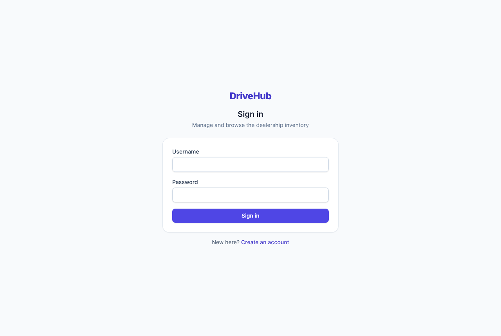
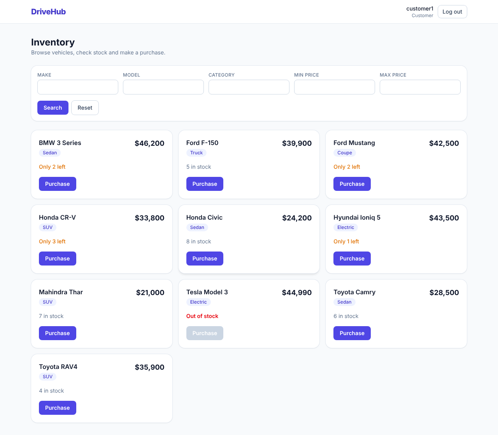
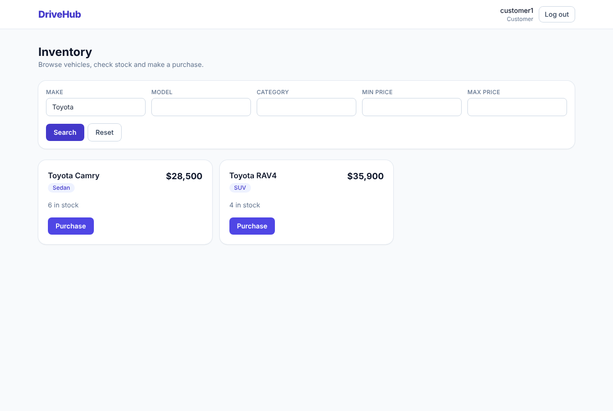
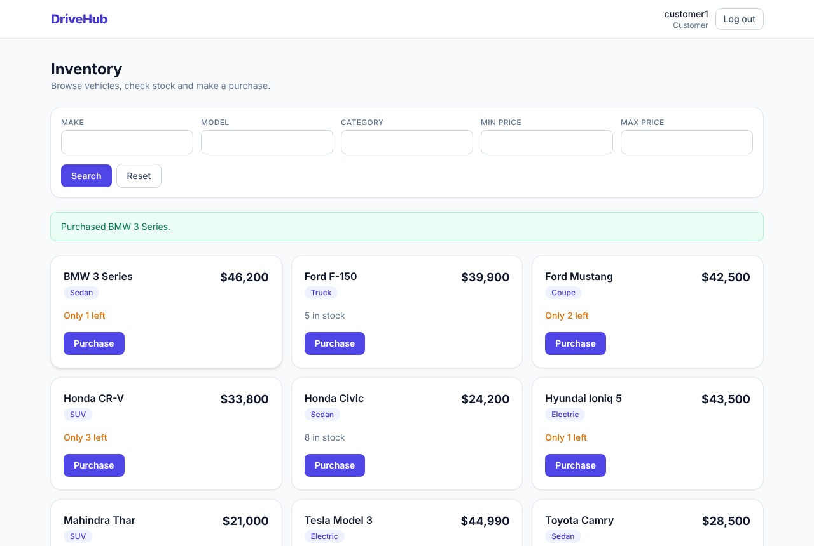
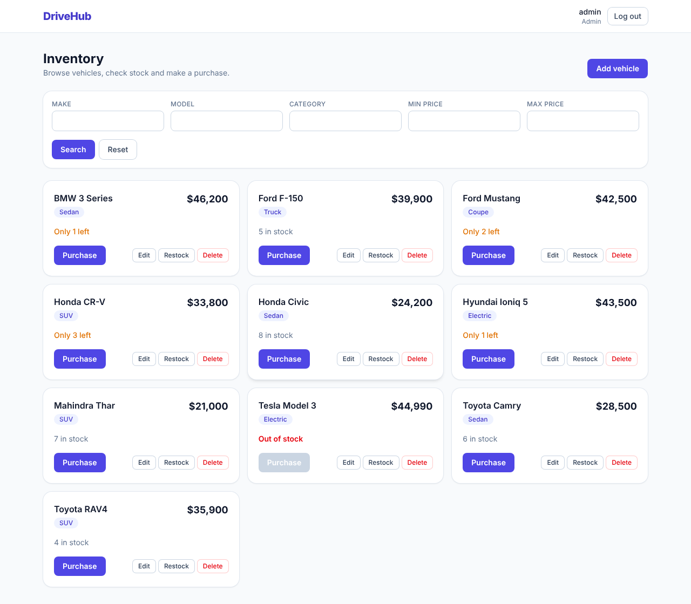
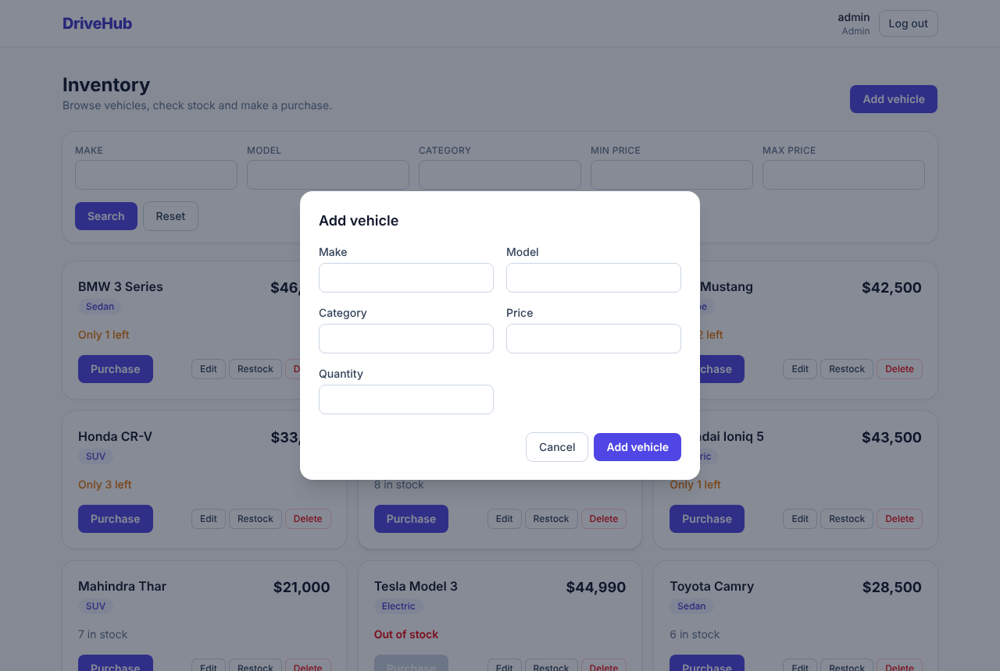
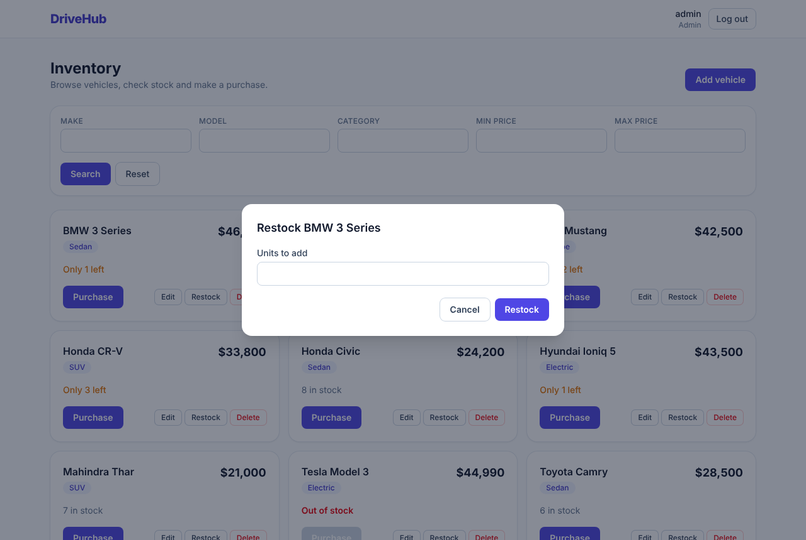

# DriveHub - Car Dealership Inventory System

A full-stack inventory system for a car dealership, built for the Incubyte AI Kata.
Customers can browse, search and purchase vehicles; admins can also add, edit, delete and restock them.

| Layer | Stack |
|---|---|
| Backend | Python 3.12+, Django 5.2, Django REST Framework, SimpleJWT |
| Database | PostgreSQL 16 (Docker) |
| Frontend | React 19 (JavaScript), Vite, Tailwind CSS v4, React Router |
| Tests | pytest, pytest-django, factory-boy / Vitest, React Testing Library |

## Screenshots

| Sign in | Customer dashboard |
|---|---|
|  |  |

| Search | Purchase |
|---|---|
|  |  |

| Admin dashboard | Add vehicle | Restock |
|---|---|---|
|  |  |  |

## Features

- Register and sign in with JWT (access token 60 min, refresh 1 day).
- Vehicle CRUD: `make`, `model`, `category`, `price`, `quantity`.
- Search by make, model, category and price range (all filters optional and combinable).
- Purchase decreases stock; the button is disabled and the API refuses when stock is 0.
- Admin-only restock and delete. Role is stored on the user (`user` or `admin`).
- Loading, empty and error states; confirm dialog before delete; responsive layout.

## Setup

Prerequisites: Python 3.12+, Node 20+, Docker.

```bash
# 1. database
docker compose up -d

# 2. backend (http://localhost:8000)
cd backend
python -m venv .venv && source .venv/bin/activate
pip install -r requirements-dev.txt
python manage.py migrate
python manage.py seed_demo_data                       # 10 sample vehicles (one sold out)
python manage.py create_admin --username admin --email admin@example.com --password 'Admin-Pass-123!'
python manage.py runserver

# 3. frontend (http://localhost:5173), in a second terminal
cd frontend
npm install
npm run dev
```

Defaults work out of the box with `docker-compose.yml`. To change them, copy `backend/.env.example` to `backend/.env` and `frontend/.env.example` to `frontend/.env`.
Anyone who registers through the UI is a customer; use `create_admin` to make an admin (it can also promote an existing user).

### Run the tests

```bash
cd backend  && python -m pytest --cov=.        # needs the database from step 1
cd frontend && npm test                        # or: npm run coverage
```

See [TEST_REPORT.md](TEST_REPORT.md) for results.

## API

All endpoints except register/login require `Authorization: Bearer <access token>`.

| Method | Path | Who | Notes |
|---|---|---|---|
| POST | `/api/auth/register` | anyone | `{username, email, password}`; always creates a `user` (role cannot be chosen) |
| POST | `/api/auth/login` | anyone | returns `{access, refresh, user}` |
| GET | `/api/vehicles` | authenticated | list |
| POST | `/api/vehicles` | authenticated | create |
| GET / PUT / PATCH | `/api/vehicles/:id` | authenticated | read / update |
| DELETE | `/api/vehicles/:id` | admin | |
| GET | `/api/vehicles/search` | authenticated | `make`, `model`, `category` (case-insensitive contains), `min_price`, `max_price` |
| POST | `/api/vehicles/:id/purchase` | authenticated | `{quantity?: int >= 1}` default 1; `409` if not enough stock |
| POST | `/api/vehicles/:id/restock` | admin | `{quantity: int >= 1}` |

Errors: `400` validation, `401` no/invalid token, `403` wrong role, `404` unknown vehicle, `409` insufficient stock.

## Design decisions

- **No overselling under concurrency.** Purchase is one atomic conditional `UPDATE ... SET quantity = quantity - n WHERE id = ? AND quantity >= n` (Django `F()` expressions) instead of read-then-write. A threaded test fires many simultaneous purchases at limited stock and checks stock never goes negative; I confirmed it fails against a naive read-modify-write version.
- **Layering.** Views handle HTTP, `services.py` holds write rules (purchase/restock), `selectors.py` holds read queries. Domain errors are mapped to HTTP codes in one place.
- **Secure by default.** DRF default permission is `IsAuthenticated`; endpoints that are public are opted out explicitly. Roles live on a custom user model.
- **Database-level guarantees.** `price >= 0` is a `CheckConstraint`; `quantity` is a `PositiveIntegerField`.
- **Create/update are open to any authenticated user** because the kata spec lists them without role limits; only delete and restock are admin-only. The UI shows add/edit controls to admins only, but the API does not enforce that. If your policy is "admins manage inventory", change `get_permissions` in `vehicles/views.py` (one line) and its tests.
- **Prices are `Decimal`** end to end (strings in JSON), never floats.
- **Tokens are stored in `localStorage`** for simplicity. That is exposed to XSS; production would use httpOnly cookies. The refresh token is issued but the UI does not use it yet (the user signs in again after 60 minutes).

## Process (TDD)

Each feature was developed red -> green -> refactor and committed in that order (`test(red): ...`, `feat(green): ...`, `refactor: ...`); see `git log`. Every commit that Claude helped with carries a `Co-Authored-By: Claude` trailer.

## My AI Usage

**Tool:** Claude (Anthropic) via Claude Code, using the Sonnet 5.5 model.

**What it did.** Claude produced the project plan (stack options, API design), the Django and React code, all tests, the seed/admin commands, the CI workflow and this README, working test-first. It also ran the code: the full test suites, a production build, and a manual end-to-end run of the real backend and frontend with Playwright to capture the screenshots.

**What the AI got wrong and how it was caught.**
- While running the real stack, sign-in and registration returned 404: the frontend called `/api/auth/login/` with a trailing slash that the backend does not have. The mocked unit tests could not see this. It was fixed with a test that pins the real paths (see the `test(red)`/`fix(green)` commits).
- Two early commit messages were reworded for clarity.
- A JWT library warning about a short dev secret key was fixed in a refactor commit.

**What I chose myself.** The stack (Django + DRF, PostgreSQL, JWT, React in JavaScript with Tailwind, Docker for the DB).

**How I reviewed it.** _(Write this yourself, honestly: what you read, ran and changed. For example: which parts you traced by hand, what you modified.)_

**Reflection.** _(Your own view: where AI sped you up, where you had to correct it, what you would do differently.)_

The full conversation is in [PROMPTS.md](PROMPTS.md).
